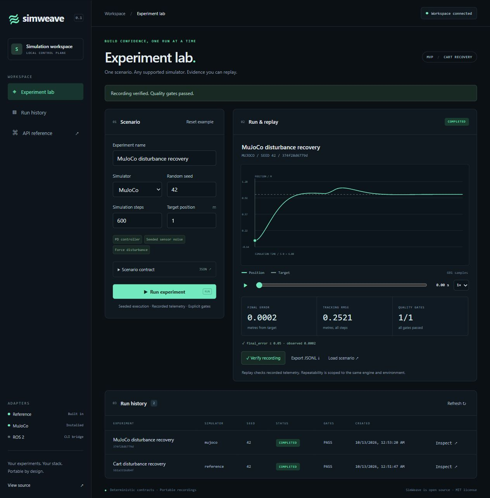

# SimWeave

Vendor-neutral simulation experiments for robotics and physical AI.

Define a world, robot, controller, sensor noise, disturbances, seed, and quality
gates in one JSON scenario. Run it headlessly, inspect telemetry, and verify the
recording. The first experiment is a one-dimensional cart recovering from a force
disturbance.



## Try the dashboard

```sh
git clone https://github.com/xsparc/simweave.git
cd simweave
python -m venv .venv
# Activate .venv (PowerShell: .venv\Scripts\Activate.ps1; POSIX: . .venv/bin/activate).
python -m pip install -e '.[mujoco]'
simweave demo
```

Open the local URL printed by the command. The demo starts the API and an
independent worker, creates a temporary session token, and connects the dashboard.
The token is carried in the URL fragment, removed from browser history on load,
and held only in tab memory. Avoid sharing that URL while the server is running.
Use Ctrl+C to stop. Runs persist in `.simweave/demo.sqlite3`; the token changes
at the next start. `simweave demo --port 8001` uses another local port.

Choose Reference or MuJoCo, edit the scenario or its full JSON contract, and run
the experiment. Select a run to inspect quality gates, play/scrub its trajectory,
verify integrity, or export a recording. No frontend build or cloud account is
required. The API, CLI, and dashboard share the same scenario contract.

The demo binds only to loopback. For persistent authentication and separately
supervised processes, follow the [service guide](docs/operations/api.md).

## Local CLI

```sh
python -m venv .venv
# Activate .venv using your shell's activation command.
python -m pip install -e '.[dev]'
simweave validate examples/cart-recovery.json
simweave run examples/cart-recovery.json --output .simweave/example
simweave replay .simweave/example
```

Output contains `scenario.json`, `result.json`, and streaming `telemetry.jsonl`.
Exit codes: 0 = gates pass, 1 = completed with failed gates, 2 = input/runtime error.
Existing output directories are never overwritten. `simweave init scenario.json`
creates a default scenario; `simweave schema` prints its JSON Schema.

The reference simulator is a small deterministic test/demo model. Repeatability
requires the same engine, adapter, dependency versions, platform, and seed;
different simulators are not expected to be numerically identical.

## Regression workflows

Run a bounded scenario/seed matrix with baseline and candidate controllers:
`simweave suite examples/cart-regression.json --output .simweave/regression`.
The supplied example needs both MuJoCo and the ROS/Gazebo fixture; set its
`adapters` to `["reference"]` for a dependency-light local trial.
Suites produce JSON/JUnit reports, a standalone `report.html`, an `evidence.zip`
bundle, and full recordings; failed quality gates
return exit 1, and execution errors return exit 2.

In the dashboard, **Baseline & candidate** overlays completed runs and shows
metric changes and failing gates. Open a suite's `report.json` to review CI
results and export a selected comparison. Follow the
[regression guide](docs/operations/regression.md) for limits, CI setup, and replay.

Open `report.html` to review a suite without the API or simulator. Inspect the
first failure, navigate gates, and export a selected pair as JSON. Use
`simweave bundle-check results/evidence.zip` to verify full recordings, or
`simweave rerun results/evidence.zip --image sha256:YOUR_64_HEX_IMAGE_ID --output rerun`
to reproduce a suite in its retained trusted container image. Follow the
[evidence guide](docs/operations/evidence.md) to capture source/image provenance
and retain the runtime. The bundle contains data; it never supplies executable code.

Try `simweave suite examples/cart-statistics.json --output results` for a portable
reference example with 30 paired seeds. Analyze it with
`simweave statistics results/evidence.zip --policy examples/decision-policy.json --output decision`.

Use `simweave calibrate` to measure synthetic decision frequencies and interval
coverage. The [calibration guide](docs/operations/calibration.md) explains the
four populations, measured undercoverage and interpretation limits.
The JSON and standalone HTML report show paired mean changes, 95% bootstrap
intervals, explicit tolerances, quality failures, and inconclusive evidence.
The `simweave history` commands record immutable builds, explicit baseline
approvals, pinned comparisons, and rollback. See the
[decision guide](docs/operations/decisions.md) for assumptions, approval commands,
local storage limits and portable CI outputs.

## Service and simulator integrations

Install `.[dev,mujoco]` for the optional physics engine. Change the scenario's
`adapter` to `mujoco` and use the same CLI. No GPU or viewer is required.

The authenticated HTTP service and durable worker run independently:
`simweave serve` and `simweave worker`. Configure the token-to-tenant mapping first
as described in the [API quickstart](docs/operations/api.md). OpenAPI lives at
`/docs`; tenant-scoped run endpoints support idempotency, cancellation, paginated
telemetry, gate verification, and portable recording export.

The [ROS/Gazebo integration](docs/operations/ros2.md) runs the built-in cart through
real headless Gazebo physics, with acknowledged forces, joint observations,
standard ROS lifecycle services, and the same metrics/gates/replay. Use
`adapter: "gazebo"` in a ROS-enabled installation. An isolated verification image
and live conformance suite are included; no host ROS install or GPU is needed
when using that image. The generic lifecycle CLI remains available for existing
external simulators. Arbitrary robot models remain outside this adapter's scope.

For a SaaS or CI integration, set `SIMWEAVE_URL` and `SIMWEAVE_TOKEN` and run
`python examples/submit.py examples/cart-recovery.json`. The standard-library
client submits a scenario, waits for completion, and exits according to its gates.

## Container

Set `SIMWEAVE_TOKENS` as described in the service guide, then:

```sh
docker compose up --build
```

The API is exposed on loopback port 8000. The worker shares a named local data
volume. Both run as an unprivileged user; no privileged mode or host Docker socket
is required. `docker compose down` stops the service and retains recordings.
See [operations](docs/operations/api.md) for backup, retention, and scaling limits.

## Shared baseline evidence

Export and restore complete decision catalogs without copying SQLite files:

```sh
simweave history export --database history.sqlite3 catalog.ndjson
simweave history restore --database restored.sqlite3 catalog.ndjson
```

The [team evidence guide](docs/operations/team-evidence.md) covers tenant-scoped
reader/importer/approver credentials, API routes, recovery limits and the
[example client](examples/catalog_client.py). Legacy run tokens keep their existing
permissions; catalog access requires explicit operator configuration.

Catalogs also support [OIDC access tokens and signed recovery](docs/operations/trusted-evidence.md).
Configure an existing issuer and server-side subject bindings, or verify a catalog's
GitHub attestation against an explicit repository/workflow/ref/commit policy before
restoring it. The synthetic CI signing workflow demonstrates provenance verification;
it does not publish a release or certify human approvals.

## Engineering

```sh
python -m pytest
ruff check .
ruff format --check .
python scripts/check_governance.py --strict
```

See [architecture](docs/architecture/overview.md), [implementation roadmap](docs/roadmap/implementation-roadmap.md),
[security boundary](docs/security/threat-model.md), and [validation](docs/governance/verification-and-validation.md).
`uv.lock` records the resolved environment; use `uv sync --frozen --extra dev`
for a locked development install.

Benchmark the streaming core with `python scripts/benchmark.py --adapter reference`
or `--adapter mujoco`. See the [validation report](docs/governance/mvp-validation.md)
for measured results and remaining integration gaps. Container runtime dependencies
are pinned with hashes in `requirements.lock`, generated from `uv.lock`.

## Stewardship

The project follows an OpenSteward research, delivery, and evidence workflow.
The [stewardship policy](docs/governance/stewardship.md) describes ongoing work and
review boundaries. New delivery PRs target `main`. When a dependency is
squash-merged, restack dependent changes and retarget before deleting its branch.

Licensed under the MIT License.
# Durable suites and artifact storage

Schedule complete regression suites through `/api/v1/suite-jobs` or the
`simweave operations` CLI. Independent local workers publish verified, immutable
bundles to filesystem or S3-compatible storage, with explicit retry after worker
loss. See [durable operations](docs/operations/durable-operations.md) for setup,
tenant permissions, limits and recovery. S3 support is optional (`simweave[s3]`);
the default SQLite scheduler remains single-host. The optional
[PostgreSQL and Keycloak integration](docs/operations/provider-distributed.md)
adds a shared suite queue and real-provider token profile (`simweave[postgres,s3]`).
Catalog storage still uses one API authority.

Catalog uploads retain original bundles, and completed jobs can be imported into
review without manual downloads. See [connected operations](docs/operations/connected-operations.md)
for authenticated artifact downloads, metrics and coordinated checkpoint recovery.


The [suite workspace and maintenance guide](docs/operations/operator-workflows.md)
covers browser submission/review, persistent admission pause, worker drain and
verified fresh-directory recovery. Open **Suite workspace** in the dashboard.

Author bounded parameter grids with [scenario sweeps](docs/operations/scenario-sweeps.md).

Inspect parameter-linked outcomes with [sweep result review](docs/operations/sweep-review.md).

Sweep reviews support a self-contained, script-free HTML view with parameter-linked
metrics and explicit incomplete-run warnings. See
[offline HTML review](docs/operations/sweep-review.md#offline-html-review).

Export validated sweep results for analysis using
[`sweep-review --format csv`](docs/operations/sweep-review.md#csv-export).

Preview run and step counts before execution with
[`sweep-inspect`](docs/operations/sweep-workload.md).

### Sweep capacity report

Omit `--output` to print the selected format. The original default JSON and `sweep-inspect-schema` remain unchanged. Capacity JSON nests the original report under `workload`, adds `max_runs` (64), `max_steps` (200000), remaining counts and adapter rows. Counts include both controllers for each seed. A 16-run, 160-step plan has 48 runs and 199840 steps of remaining admission capacity. HTML shows the same counts, parameter points and sweep/suite identities. See [the workflow](docs/operations/sweep-workload.md).

### Capacity export contracts

CSV schema version 1 has one row per adapter in declared order. adapter_runs/adapter_steps are local totals; total_runs/total_steps, max_runs/max_steps and remaining_runs/remaining_steps describe the whole plan on every row. sweep_name_text carries a literal text: prefix. Digests identify the Sweep and expanded Suite. Omit --output for stdout; both routes preserve UTF-8 and CRLF. See [the workflow](docs/operations/sweep-workload.md).

### Directional sweep plan comparison

The first input is before and the second is after; all deltas are after minus before. An admitted comparison exits 0 whether or not plans differ; invalid input/I/O exits 2. Omit --output for stdout. JSON includes before/after snapshots, signed run/step/headroom changes, ordered adapter changes and identical_inputs. A zero count delta does not establish experiment equivalence. See [the workflow](docs/operations/sweep-plan-diff.md).
