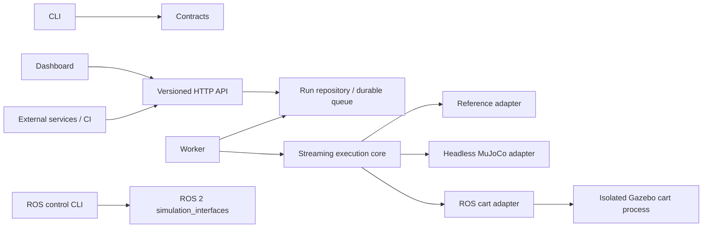

# Architecture

SimWeave runs reproducible, simulator-independent experiments. The MVP controls
a one-dimensional cart using a PD controller, seeded position noise, timed force
disturbances, scalar metrics, and pass/fail gates. All quantities use SI units.

## Boundaries

The engine imports neither HTTP nor persistence. Adapters implement reset, step,
and close. A fixed registration table prevents scenario-supplied code execution.
ROS control is a separate capability-checked bridge; generic ROS services do not
provide the cart actuator and sensor contract. The Gazebo adapter adds a built-in
cart fixture with acknowledged forces and native joint observations. Each run
owns a headless Gazebo process, separate ROS context, namespace, and transport
partition. The UI exposes the fixture when its operator-installed runtime is
available. Arbitrary ROS robots remain outside this adapter. See ADR 0002.

## Interoperability and portability

Version 1 JSON scenarios have a generated JSON Schema, strict types, finite
numbers, unknown-field rejection, and bounded steps. `/api/v1` and OpenAPI define
the service boundary. JSON/JSONL recordings remain usable without the service.
The reference adapter needs no GPU, ROS installation, or platform-specific build.
MuJoCo is an optional dependency, loaded lazily. ROS is installed by the operator
in a ROS-supported environment and is optional for reference/MuJoCo deployments.
Gazebo experiments require the compiled fixture and matching ROS environment in
both the API and worker. The Python package alone does not install ROS/Gazebo.

## Execution and persistence

The API submits durable jobs; a separate worker claims them transactionally.
Each run stores its normalized scenario, digest, engine and simulator versions,
metrics, gate results, and ordered telemetry. Batched inserts and cursor pagination
bound memory and response sizes. SQLite WAL is the single-host MVP store on a
local filesystem. Do not network-mount SQLite. The optional PostgreSQL suite
queue supports separate workers; legacy run storage remains single-host. Worker leases detect abandoned runs; expired work fails explicitly instead
of silently repeating simulator side effects. Completed recordings are immutable.

Tenant identity comes from server-side credential/subject mappings, never request JSON.
Repository queries scope reads and mutations to the authenticated tenant. Quotas,
request limits, and cancellation constrain work. API and worker processes can be
replaced separately. PostgreSQL suite claims and S3 bundles are optional;
legacy telemetry migration, billing, per-tenant scheduling,
distributed tracing, and isolation of third-party simulators are later work.

## Determinism and replay

The clock advances only by the scenario timestep. A per-run PRNG isolates sensor
noise. Reset reconstructs state. Repeatability is scoped to the same adapter,
engine, dependencies, platform, and scenario; different physics engines may
produce different results. The reference cart uses semi-implicit Euler. Telemetry
sample zero is initial state; sample i contains state after step i and forces
applied during that step. Observations use seeded noise; velocity is exact.

RMSE excludes initial state, maximum position includes it, and control effort is
the timestep integral of absolute controller force (excluding disturbances).
Disturbance intervals are zero-based and half-open. Replay verifies record order,
clock, digests, metrics, and gates. It is recording playback, not proof of original
physics or a signed attestation. Rerunning a scenario is a separate operation.

## Performance budget

Regression suites expand a closed v1 matrix into baseline/candidate pairs and
reuse the streaming engine sequentially. They are bounded to 64 runs and 200,000
total steps and produce full recordings, JSON summaries, and JUnit results. The
pure comparison layer validates matching physical inputs and computes signed
metric deltas and explicit increase limits. CLI reports and tenant-scoped API
comparisons share this logic. The dashboard opens bounded suite reports without
importing jobs or accessing file paths; imported previews are not replay evidence.
See ADR 0003 and the regression operations guide.

Completed suites also emit a self-contained offline HTML report and bounded,
checksummed JSON/JSONL evidence bundle. The bundle reader never extracts paths;
it verifies full recordings and their plotted previews. Runtime fingerprints and
explicit optional source/image provenance live alongside the existing v1 report,
preserving API and recording compatibility. A separate operator-invoked container
runner checks an explicitly selected retained image and installed runtime before
executing the suite, then compares full telemetry/results. This runner has no API
endpoint or Docker socket in the service. See ADR 0004 and the evidence guide.

The pure statistics layer analyzes paired mean changes within a scenario/adapter
using an explicit policy and bounded seeded resampling. Incomplete, degenerate,
small or confounded populations remain inconclusive. A separate local catalog
imports verified build summaries and records immutable baseline/policy approvals,
comparisons and rollback events. Generation checks serialize competing approvals;
comparison outputs pin an event and content digests. Script-free HTML and versioned
JSON keep review portable without a statistical runtime dependency. ADR 0005
defines the local catalog; ADR 0006 adds canonical archives and explicit tenant
baseline API permissions. Server configuration selects separate catalogs and
approval identities. Legacy run tokens do not gain catalog access. Restoration
remains an operator action into a fresh database; no API accepts database paths
or replaces approval history. See the team evidence guide for limits.

ADR 0007 adds optional catalog access tokens from one pinned OIDC issuer. Verified
subjects map to tenant roles and stable audit aliases; scopes restrict that mapping.
RS256 signature, audience, issuer, lifetime and key-cache bounds fail closed. Static
tokens remain supported. The run API does not gain OIDC catalog authority.
Operator-only attestation verification delegates cryptographic provenance checks to
GitHub CLI with explicit repository/workflow/ref/commit policy. Verified restore
uses the exact snapshotted archive bytes. CI signs synthetic evidence only; signatures
do not establish human approval or physics correctness.

At most 20,000 steps, 64 disturbance intervals, and 16 gates per run. Workers
stream samples and flush batches rather than retain a complete trajectory.
Measure throughput with the supplied benchmark before changing these limits.
No real-time or hard latency guarantee is made. See the operations guide for
deployment constraints and storage retention.

ADR 0008 adds a separate leased suite queue and immutable tenant-scoped artifact
index with filesystem/S3 backends. Four local processes can execute complete
suites; cancellation, lease expiry and attempt claims fence stale completions.
Explicit retry is required after worker loss. Bundle publication precedes metadata
and job completion; interrupted publications may leave conservatively retained
objects. The engine remains independent. See the durable operations guide for
capacity, recovery, credentials and the default SQLite scheduling boundary.
The optional distributed suite boundary is described below.

ADR 0009 connects verified artifact bytes to catalog uploads and completed suite
jobs, with separate run/catalog download authorities. Snapshot downloads are
bounded and verified before sending. Durable fixed-name metrics report queue
state, lease loss, worker freshness and artifact operations. Operator-quiesced
checkpoints include queue/catalog/index snapshots plus verified object bytes;
fresh-directory restore validates references and resets worker presence. The
connected operations guide defines the recovery boundary and legacy backfill.

## Operator workflows

ADR 0010 adds a browser suite workspace using the existing tenant APIs, plus a
persistent rollback-journal admission fence beside the suite queue. Claims and
catalog mutations hold read reservations; pause commits after admitted mutations
finish. Worker completion remains permitted so drain can finish. Checkpoint holds
the paused fence and publishes verified state; restores begin paused. Resume and
acknowledgement of terminated workers are explicit operator CLI actions.

ADR 0012 extends the workspace with explicit approver confirmation and recorded
decision/history review. Requests capture the expected generation, build or rollback
target, policy and reason. Existing server roles and immutable catalog transactions
remain authoritative; failures require refreshed review, never automatic retries.
See [guided review](../operations/guided-review.md).

## Optional provider/distributed boundary

ADR 0011 adds an explicit Keycloak access-token profile and PostgreSQL suite queue
with shared S3 artifact metadata. Database-time leases, attempt fences, bounded
pools and transactional admission preserve the existing suite contracts. Catalogs
and legacy runs still belong to a single API host. SQLite defaults and recovery
remain supported; PostgreSQL recovery/migration is not implemented. See
[operator setup](../operations/provider-distributed.md) for configuration and limits.
