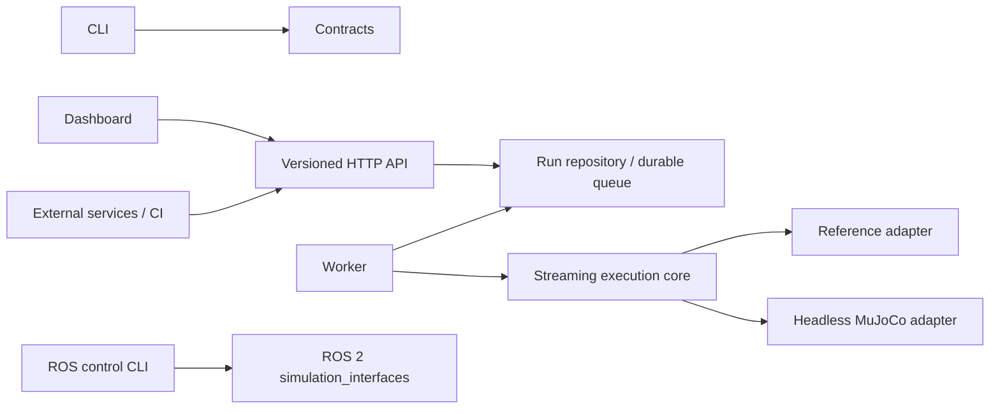

# Architecture

SimWeave runs reproducible, simulator-independent experiments. The MVP controls
a one-dimensional cart using a PD controller, seeded position noise, timed force
disturbances, scalar metrics, and pass/fail gates. All quantities use SI units.

## Boundaries

The engine imports neither HTTP nor persistence. Adapters implement reset, step,
and close. A fixed registration table prevents scenario-supplied code execution.
ROS control is a separate capability-checked bridge; generic ROS services do not
provide the cart actuator and sensor contract. Full ROS experiments require a
future robot-specific adapter. This distinction must remain visible in the UI.

## Interoperability and portability

Version 1 JSON scenarios have a generated JSON Schema, strict types, finite
numbers, unknown-field rejection, and bounded steps. `/api/v1` and OpenAPI define
the service boundary. JSON/JSONL recordings remain usable without the service.
The reference adapter needs no GPU, ROS installation, or platform-specific build.
MuJoCo is an optional dependency, loaded lazily. ROS is installed by the operator
in a ROS-supported environment and is never required by the server.

## Execution and persistence

The API submits durable jobs; a separate worker claims them transactionally.
Each run stores its normalized scenario, digest, engine and simulator versions,
metrics, gate results, and ordered telemetry. Batched inserts and cursor pagination
bound memory and response sizes. SQLite WAL is the single-host MVP store on a
local filesystem. No network-mounted SQLite volumes and no multi-host scaling
claim. Worker leases detect abandoned runs; expired work fails explicitly instead
of silently repeating simulator side effects. Completed recordings are immutable.

Tenant identity comes from a server-side bearer-token mapping, never request JSON.
Repository queries scope reads and mutations to the authenticated tenant. Quotas,
request limits, and cancellation constrain work. API and worker processes can be
replaced separately. Hosted evolution replaces the repository with PostgreSQL job
claims and object storage for telemetry; OIDC, billing, per-tenant scheduling,
distributed tracing, and isolation of third-party simulators are later work.

## Determinism and replay

The clock advances only by the scenario timestep. A per-run PRNG isolates sensor
noise. Reset reconstructs state. Repeatability is scoped to the same adapter,
engine, dependencies, platform, and scenario; different physics engines may
produce different results. The reference cart uses semi-implicit Euler. Telemetry
sample zero is initial state; sample i contains state after step i and forces
applied during that step. Observations use seeded noise; velocity is exact.

RMSE excludes initial state, maximum position includes it, and control effort is
the timestep integral of absolute controller force (excluding disturbances).
Disturbance intervals are zero-based and half-open. Replay verifies record order,
clock, digests, metrics, and gates. It is recording playback, not proof of original
physics or a signed attestation. Rerunning a scenario is a separate operation.

## Performance budget

At most 20,000 steps, 64 disturbance intervals, and 16 gates per run. Workers
stream samples and flush batches rather than retain a complete trajectory.
Measure throughput with the supplied benchmark before changing these limits.
No real-time or hard latency guarantee is made. See the operations guide for
deployment constraints and storage retention.
